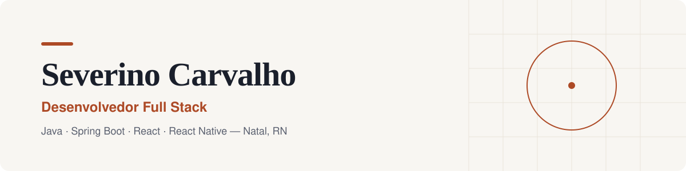
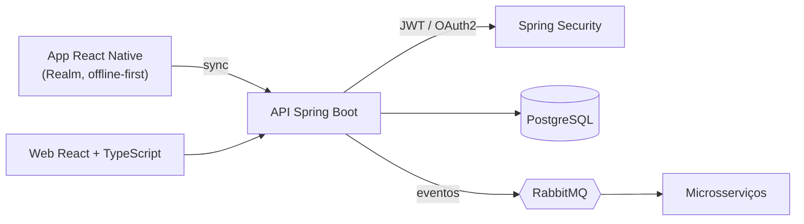

<picture>
  <source media="(prefers-color-scheme: dark)" srcset="./assets/banner-dark.svg">
  
</picture>

 

  

<picture>
  <source media="(prefers-color-scheme: dark)" srcset="./assets/numbers-dark.svg">
  
</picture>

## Sobre mim

Desenvolvedor Full Stack com experiência construindo sistemas que resolvem problemas reais, do back-end ao mobile. Na **IDUS**, digitalizo processos do setor de **óleo e gás** que antes viviam em planilhas e papel, entregando sistemas usados no dia a dia da operação.

- Desenvolvedor Full Stack na **IDUS** desde abr/2023
- Cursando **Bacharelado em Tecnologia da Informação** na UFRN
- Código que se lê: Clean Code, funções pequenas e Code Review

## Como eu trabalho

- **Ponta a ponta**: entendo o problema inteiro, da modelagem do banco até a tela que o usuário toca. Isso evita decisões de front-end que não fazem sentido para o back-end, e vice-versa.
- **Aprender fazendo**: testo uma tecnologia construindo algo com ela antes de confiar nela num projeto sério.
- **Código que se lê**: prefiro nomes claros e funções pequenas a comentários explicando código confuso.

## Stack

**Back-end**

**Front-end & mobile**

**Dados & infra**

Também: Spring Security · JPA/Hibernate · JWT/OAuth2 · REST APIs · React Native · Realm (offline-first)

## Destaques técnicos

- **Offline-first no mobile**: app React Native com Realm, que funciona sem conexão e sincroniza quando a rede volta.
- **Mensageria entre microsserviços**: integração assíncrona com RabbitMQ.
- **Segurança**: autenticação e autorização com Spring Security, JWT e OAuth2.
- **Digitalização de processos**: planilhas e papel substituídos por fluxos automatizados, com modelagem em PostgreSQL e JPA/Hibernate.

## Arquitetura que costumo construir

## Experiência

**Desenvolvedor Full Stack · IDUS** · _Natal, RN · abr/2023 até hoje_

- **Digitalização de processos para o setor de óleo e gás**: sistema em produção que troca planilhas e papel por fluxos automatizados. APIs REST, modelagem de banco de dados, integração entre módulos e módulos mobile em React Native.
- **Sistema de monitoramento de alarmes industriais**: atuação desde o início do projeto, cuidando de interfaces, APIs REST, modelagem de dados e integração entre microsserviços via mensageria.

## Formação

| Curso | Instituição | Período |
| --- | --- | --- |
| Bacharelado em Tecnologia da Informação | UFRN | 2026 até hoje |
| Técnico em Programação para Internet | IMD/UFRN | 2020 a 2022 |
| Técnico em Informática | IFRN, Campus João Câmara | |

 

<picture>
  <source media="(prefers-color-scheme: dark)" srcset="https://raw.githubusercontent.com/severino-carvalho/severino-carvalho/output/snake-dark.svg">
  
</picture>

---

Tem um projeto em mente ou quer trocar uma ideia? **[Fale comigo](mailto:severinocarvalho14@gmail.com)** · Veja mais em **[severinocarvalho.dev](https://severinocarvalho.dev)**

